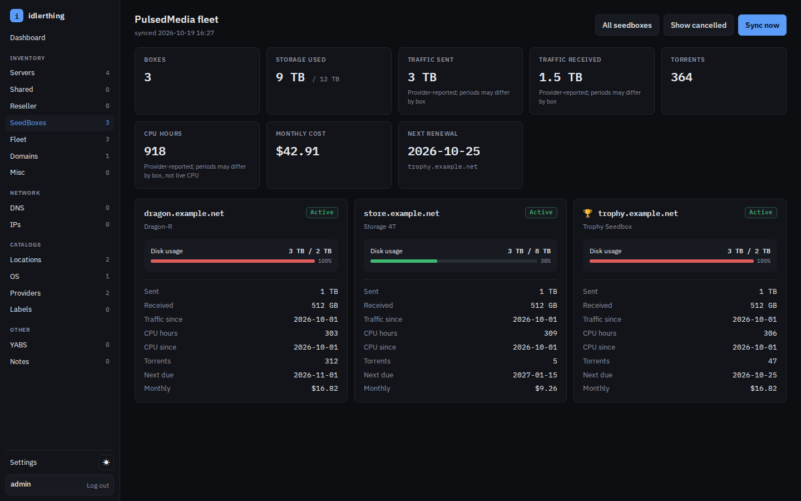
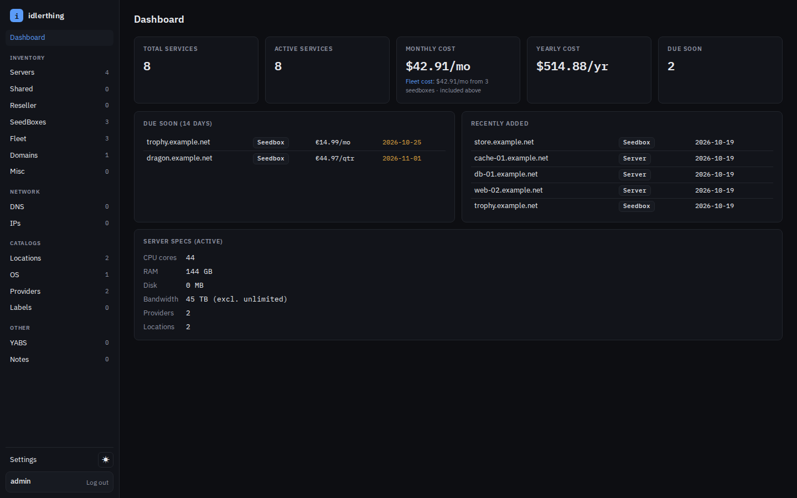
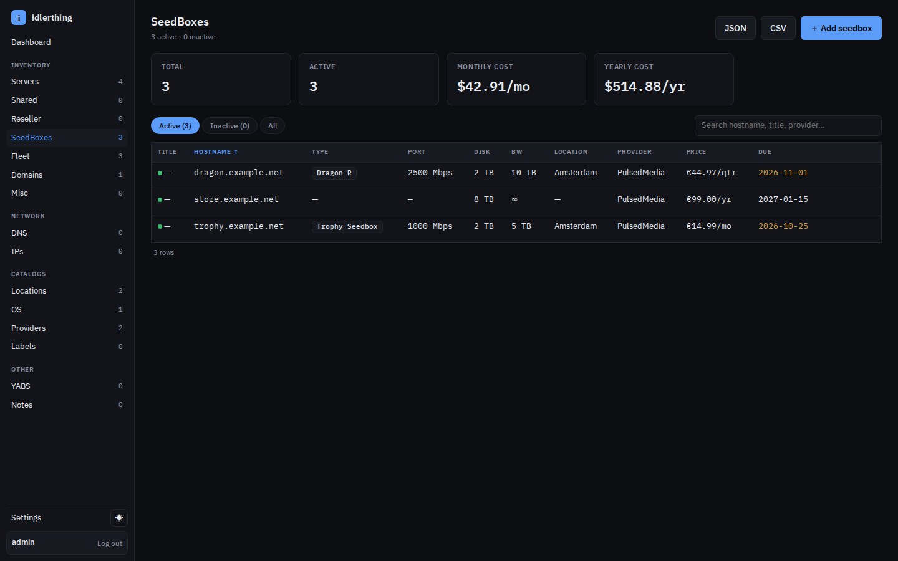
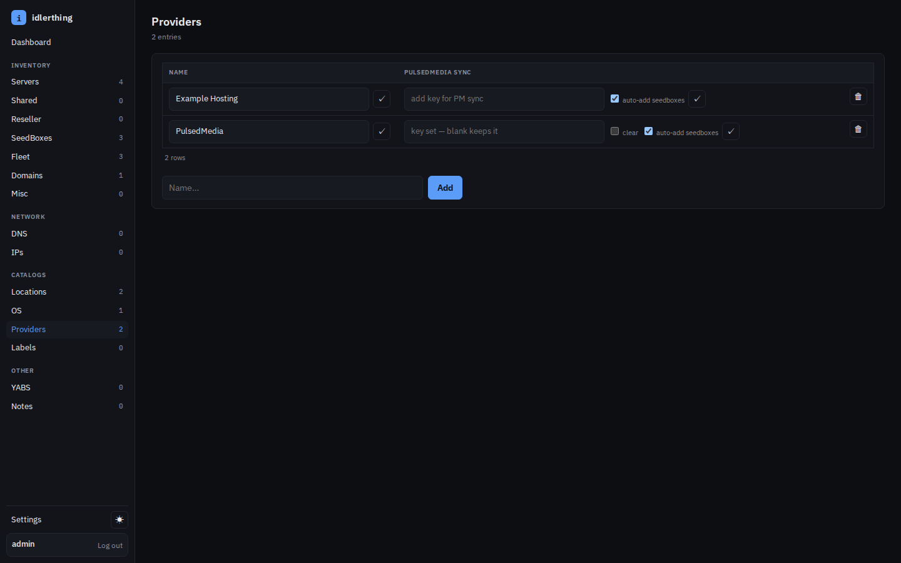

# idlerthing

A lightweight, single-binary, self-hosted inventory for hosting services —
inspired by my-idlers, reimplemented in Go. Track servers, shared hosting,
reseller hosting, seedboxes, domains, and misc services with pricing and
due-date awareness, labels, notes, IPs (with whois), DNS records, and YABS
benchmarks. SQLite storage, no cgo, no external services required.

## Features

- **Inventory** — six service types with dense, htmx-powered list pages
  (search, sort, status tabs), forms, and detail pages.
- **Dashboard** — monthly cost (converted via live exchange rates), due-soon
  list with automatic due-date rollover, recently added, spec summary.
- **Labels, notes, IPs, DNS** — attachable to every service; whois refresh
  via ipwho.is; lazy due-date advancement.
- **Settings** — currencies, due-soon window, theme (dark/light), password
  change, API token management.
- **JSON API** — Bearer-token read access to everything, full CRUD for
  servers, paginated.
- **Export/import** — full JSON export plus a CSV zip for spreadsheets. Restore
  with `idlerthing import`, which reads this app's own JSON export, a
  my-idlers JSON dump, or a my-idlers CSV — the format is detected from the
  file, not from its extension.
- **YABS** — signed ingest URLs for yabs.sh results, run history and views.
- **PulsedMedia provider** — put a read-only customer-API key on a provider
  and its services sync into a fleet view: disk against quota, traffic,
  CPU-hours, torrents, next renewal and monthly cost, per box and in total.
- **Public page** — optional read-only `/public` server list.

## Demo

These screenshots use invented data from the [screenshot harness](scripts/screenshots/README.md); no live account or host is shown.





<details>
<summary>More screenshots</summary>





</details>

## Quick start

```sh
make build
./idlerthing
# open http://127.0.0.1:8080 — log in as admin@localhost
```

On first run an admin user is created with a generated password, written to
`<IDLER_DB>.admin-password` at mode 0600; stderr names the file **once** (look
for `First run: the admin password is in ...`). Read it, sign in as
`admin@localhost`, and the file is deleted automatically. The password never
goes to the log stream, because a journal entry is retained, group-readable,
and often forwarded long after you need the credential. To choose the password
instead, set `IDLER_ADMIN_PASSWORD` (8–72 bytes, the same policy as
**Settings → Account**) before the first start.

## systemd

`idlerthing.service` (repo root) runs the app as a hardened dynamic user:

```sh
sudo install -m 0755 idlerthing /usr/local/bin/idlerthing
sudo install -m 0644 idlerthing.service /etc/systemd/system/idlerthing.service
sudo install -d -m 0750 /etc/idlerthing
sudo install -m 0600 /dev/null /etc/idlerthing/idlerthing.env
sudo systemctl daemon-reload
sudo systemctl enable --now idlerthing
```

The env file stays empty unless you want to set variables explicitly. On first
start the generated admin password is written next to the database at 0600 and
the journal names the file, never the secret:

```sh
sudo journalctl -u idlerthing | grep 'admin password'
sudo cat /var/lib/idlerthing/data/idlerthing.db.admin-password
```

The first successful login deletes it, so read it before you sign in. If the
file is already gone, `idlerthing passwd` sets a new one (stop the service
first, and point `IDLER_DB` at the real database — see [CLI](#cli-commands)).

The database lands in `/var/lib/idlerthing/data/` (default `IDLER_DB` is
relative to the unit's `WorkingDirectory`). See the comments in the unit file
for memory limits, hardening notes, and the `CAP_NET_RAW` caveat for the
in-app ping tool.

## Banning brute-force logins (fail2ban)

idlerthing logs authentication events to stderr — the systemd journal — in a
fail2ban-friendly form. The binary calls `log.SetFlags(0)` because journald
already stamps every entry, so a line is exactly:

```
WARN login: failed authentication from=203.0.113.7 user=someone@example.com
WARN login: rate-limited from=203.0.113.7
WARN login: failed password-change verification from=203.0.113.7
INFO login: authenticated from=203.0.113.7 user=admin@localhost
```

The attempted username is attacker-controlled, so it is only ever emitted
**after** the address (and slog escapes it) — a crafted value cannot shift the
filter's `<HOST>` capture. Successful logins are audited in the same stream and
excluded by the filter's `ignoreregex`. Blocked attempts log at most once per
minute per source, so a flood of already-refused requests cannot amplify into
unbounded journald writes.

Built-in limits, independent of fail2ban: 10 attempts per minute per source
(shared by the login form and the Settings → Account password change, so a
stolen session cannot guess the real password unthrottled) and 10 per minute
per account. The per-account limit spares addresses that have signed in
before, so a stranger hammering the admin account cannot lock the owner out
from a familiar address — it still applies in full to everyone else.

A ready-made filter and jail ship in [`deploy/fail2ban/`](deploy/fail2ban):

```sh
sudo install -m 0644 deploy/fail2ban/idlerthing.conf /etc/fail2ban/filter.d/idlerthing.conf
sudo install -m 0644 deploy/fail2ban/jail.local      /etc/fail2ban/jail.d/idlerthing.conf
sudo systemctl restart fail2ban
sudo fail2ban-client status idlerthing
```

> **The address is only the real client when the deployment says so.** It is
> idlerthing's rate-limiter key, which trusts `X-Forwarded-For` only with
> `IDLER_BEHIND_TLS_PROXY=1`. Without that, behind a reverse proxy, every line
> carries the *proxy's* address — and banning it locks out everyone. Fix the
> config before enabling the jail.

The jail bans with the native `nftables` backend, since Debian 13 ships no
iptables by default, and covers TCP and UDP so a ban also applies over QUIC.

## PulsedMedia provider

idlerthing can read the PulsedMedia customer API ("your own services"), so
renewals, quota and live usage come from the provider instead of being typed
in by hand.

1. Create a read-only API key in the client area (`?m=pmapi`).
2. **Providers** → choose the provider record for this account and paste the key
   into its **PulsedMedia API key** field. A provider with a key is included
   when you press **Sync now**; the provider name is not matched and there is
   no separate checkbox. Leave the field blank to keep the key, or
   check **clear** to disable sync. The key is write-only: it is stored, never
   rendered back into the page, and never exported.
3. **Fleet** (in the sidebar, beside SeedBoxes) → **Sync now**.

The Fleet link appears as soon as any provider holds a key, and its count is the
number of seedboxes that are linked — zero right after you add the key, which is
correct: nothing is linked until the feed has been fetched once and matched.

Every service on the account is cached locally. A seedbox is linked
only when its hostname uniquely matches a service domain or permanent address.
Other seedboxes stay unlinked for you to pick in the **PulsedMedia service**
field on the seedbox form. A link you set by hand is never overwritten.

The sync writes only what you have not made your own. A renewal date, price or
quota is taken from the feed while the field is empty or still holds the value
the feed itself wrote last time, and anything you typed wins. A billing cycle
idlerthing cannot represent leaves the price alone rather than guessing a
monthly cost. Cancelled and suspended services sit behind a **Show cancelled**
toggle and never count towards the totals.

The fleet view reads the cache only, so a slow or failing feed never blocks a
page. It shows the most recent sync time and marks stale data per provider — a
provider whose feed has stopped is flagged on its cards, and the header shows a
single stale badge meaning at least one provider's feed is older than six hours,
even when another provider synced recently.

Nothing is installed on a seedbox. With SSH polling off (the default), no
connection is made to one: the feed is a single outbound HTTPS request to
`pulsedmedia.com`. The API key reaches
no export, no JSON API response and no unauthenticated route. The key **is**
stored in the SQLite database; protect the DB, its WAL/SHM files and any raw
backups as secrets (the app sets DB/WAL/SHM permissions to 0600). Application
JSON/CSV exports do not include the key; restore it separately if needed.

## Optional SSH metrics polling

Seedboxes remain passive unless you opt a box in under **Edit seedbox →
Optional SSH polling** and press **Poll SSH metrics** on its detail page.
An imported backup restores inventory and SSH username, but deliberately
resets every network-polling switch; re-enable each locally after restore.
Manual read-only polling fetches only the host load and memory metrics you
select. Separate account disk-quota and traffic-limit/throttle options read
only the chosen PMSS accounting files. The directory option measures
and privately retains the largest top-level home entries (up to 500) and an
aggregate remainder; directory names stay out of JSON/CSV exports. The
rootless Docker option reads container counts through the SSH account's
socket, requiring remote `curl`. A separate manual qBittorrent observation
reads torrent count and rates from an SSH-account-owned localhost WebUI on
port 8080; it requires localhost authentication bypass and sends no WebUI
credentials. If authentication is required, observation is unavailable.
The whole manual SSH poll has a two-minute deadline. The latest result, UTC
attempt time and a generic failure state remain on the seedbox detail page
after refresh. No CPU utilization percentage is implied by the load average.
It does not collect per-box disk I/O or poll in the background. No agent or
seedbox installation is involved.

The app's OS user needs a non-interactive, unencrypted SSH private key
(standard `~/.ssh/id_*` files with private permissions) and a pre-verified
entry for that hostname in `~/.ssh/known_hosts`. Strict host-key checking is
required; never trust a key obtained from an unverified network scan. The
app stores only the opt-in and SSH username, never a password or private key.
Disabled/inactive boxes are never polled. Host load/memory polling times out
after 12 seconds; directory measurement has a two-minute limit. Failed polls
report a generic error without showing SSH output or changing inventory. If the
app runs as a systemd `DynamicUser`, provision its SSH identity and
known_hosts via a private credential/home mechanism before enabling this
option; the default service unit does not provide them. Do not enable it if
the app host should have no network path to your boxes.

## Configuration

| Variable              | Default                  | Purpose                                  |
| --------------------- | ------------------------ | ---------------------------------------- |
| `IDLER_ADDR`          | `127.0.0.1:8080`         | HTTP listen address                      |
| `IDLER_DB`            | `./data/idlerthing.db`   | SQLite file path                         |
| `IDLER_ADMIN_PASSWORD`| *(none)*                 | First-run admin password (seed only)     |
| `IDLER_SECRET`        | *(generated)*            | YABS ingest HMAC key, **minimum 16 bytes**; persisted to `<db>.secret` (0600) when unset. A shorter value — from the env var or the file — is a fatal startup error, not a warning |
| `IDLER_BEHIND_TLS_PROXY` | *(off)*             | Set `1`/`true`/`yes` behind an HTTPS-terminating proxy: session cookies go `Secure` and the last `X-Forwarded-For` IP is trusted |
| `IDLER_BASE_URL`      | *(none)*                 | External URL used in the YABS ingest command (default: request scheme+Host) |
| `IDLER_ALLOW_HTTP_INGEST` | *(off)*              | Allow plain-http YABS ingest URLs on LAN hosts (loopback http and https always work) |
| `IDLER_PMAPI_URL`     | `https://pulsedmedia.com/remote/pmapi-feed.php` | Override the PulsedMedia customer-API endpoint (for tests and mocks) |

## CLI commands

The subcommands live in the same binary as the server and read the **same
environment**, above all `IDLER_DB`:

```sh
sudo systemctl stop idlerthing
sudo IDLER_DB=/var/lib/idlerthing/data/idlerthing.db idlerthing passwd
sudo chown --reference=/var/lib/idlerthing /var/lib/idlerthing/data/idlerthing.db*
sudo systemctl start idlerthing
```

That matters more than it looks: the default `IDLER_DB` (`./data/idlerthing.db`)
is relative to the **current directory**, while the unit runs with
`WorkingDirectory=%S/idlerthing`. A bare `idlerthing passwd` from your shell
therefore targets a different file — and, if it does not exist, creates an empty
database at 0600 that the service never reads.

| Command                           | What it does                                                        |
| --------------------------------- | ------------------------------------------------------------------- |
| `idlerthing`                      | run the web server in the foreground (the unit's `ExecStart`)       |
| `idlerthing import [--force] <f>` | import this app's JSON export, a my-idlers JSON dump, or a CSV      |
| `idlerthing passwd`               | reset the admin password, revoking every session and the API token  |
| `idlerthing version`              | print the build version                                             |
| `idlerthing help`                 | show the usage text                                                 |

`import` and `passwd` open the database directly, so stop the service first:
SQLite takes one writer at a time, and a second process gives up after the
5-second `busy_timeout` with `database is locked`. `passwd` reads the new
password from standard input, or generates one when it is attached to a terminal
— arguments are refused because other local users can read command lines.

Because the unit runs as a `DynamicUser`, the CLI has to run as root to touch
that database at all, which leaves root-owned files behind: the `chown
--reference` above hands them back to the owner of `/var/lib/idlerthing`. If you
are signed in, **Settings → Account** changes the password without any of this.

## Backup & restore

The database file is the whole application — services, prices, notes, labels,
YABS history, settings, and the provider API keys. Treat it as a secret: the
PulsedMedia key is stored inside it (the app keeps the database at 0600 for
exactly that reason), and so is the ingest HMAC secret beside it.

| Path                          | What it is                                                                                     |
| ----------------------------- | ---------------------------------------------------------------------------------------------- |
| `<IDLER_DB>`                  | the SQLite database                                                                              |
| `<IDLER_DB>-wal` / `-shm`     | WAL sidecars — the newest commits may still be in `-wal`, so copy all three or none             |
| `<IDLER_DB>.secret`           | the generated YABS ingest HMAC key (absent when you set `IDLER_SECRET`); delete to regenerate   |
| `<IDLER_DB>.pre-NNNN.sqlite`  | written automatically before an upgrade; the rollback copy (see below)                          |
| `<IDLER_DB>.admin-password`   | first-run only, deleted on the first successful sign-in — a live credential, not a backup item  |

Stop the service, then copy the directory. Snapshots are never pruned on your
behalf: an upgrade writes `<db>.pre-<version>.sqlite`, where `version` is the
first migration it is about to apply, and aborts instead of running if that copy
cannot be made. Delete the snapshots you no longer need.

- Export in the UI (JSON per type or full, CSV zip) or via
  `GET /export/json`. Per-type JSON exports are **partial** — they omit
  related records (pricings/ips/dns/notes/labels/yabs) and are marked
  `"partial": true`; only a full export restores everything.
- Restore: `idlerthing import [--force] backup.json` — the format is detected
  from the file, so this also takes a my-idlers JSON dump or CSV export. The CSV
  zip the UI produces is for spreadsheets; it is not the my-idlers CSV shape and
  will not import. Current exports carry a `"format": 1` envelope marker;
  older backups without one restore as **legacy format** (with a warning),
  while an unrecognized marker is rejected. Catalogs are merged by name;
  services are always inserted fresh, so importing into a non-empty
  database requires `--force` (and duplicates services). Users, sessions,
  and settings are never imported.
- Imported hostnames are limited to 253 bytes. Import diagnostics abbreviate
  long values and retain at most 1,000 warnings, including a suppression notice.

## Upgrading

- Early docs showed example admin passwords verbatim. If your deployment
  dates from that era, the server logs a loud warning at startup when the
  admin password matches one — reset it with **Settings → Account**, or with
  `idlerthing passwd` when you are locked out (it reads the new password from
  standard input, and only prints a generated one when attached to a terminal).
  Password arguments are rejected because
  other local users may be able to see command lines. All sessions and the API
  token are revoked either way.

## JSON API

Generate a token in **Settings → API token**, then:

```sh
curl -H "Authorization: Bearer $TOKEN" http://127.0.0.1:8080/api/servers
```

- Read: `/api/servers`, `/api/shared`, `/api/reseller`, `/api/seedboxes`,
  `/api/domains`, `/api/misc`, `/api/pricings`, `/api/ips`, `/api/dns`,
  `/api/labels`, `/api/notes`, `/api/providers`, `/api/locations`, `/api/os`
  (lists paginate with `?page=&per=`).
- Write (servers only): `POST /api/servers`, `PUT /api/servers/{id}`,
  `DELETE /api/servers/{id}`.

## YABS ingest

Every server detail page shows a signed command:

```sh
curl -fsSL --proto '=https' https://yabs.sh | bash -s -- -s 'https://your-host/api/yabs/1?sig=...&ts=...'
```

Run it on the server; the benchmark (system info, geekbench, fio disk
speeds, iperf network speeds) appears under **YABS**. Signatures are
HMAC-SHA256 over `{server_id}.{ts}` — valid for 2 hours, single-use
(after a run lands, refresh the server page for a fresh command);
duplicate submissions are ignored.

## Tech notes

- Go stdlib only: `net/http`, `html/template`, `embed` — plus
  `modernc.org/sqlite` (pure-Go SQLite, no cgo) and
  `golang.org/x/crypto/bcrypt`.
- htmx + hand-rolled CSS (IBM Plex Sans/Mono, dark & light themes), strict
  CSP, no JavaScript framework.
- Single writer connection (`SetMaxOpenConns(1)`), WAL mode, hand-rolled
  `PRAGMA user_version` migrations.
- All size/bandwidth values are stored in whole MB, 1024-based
  (1 GB = 1024 MB, 1 TB = 1024 GB); the UI enters/displays friendly units
  and converts server-side. NULL bandwidth means unlimited (∞).

## License

idlerthing is free software under the **GNU Affero General Public License v3
or later** ([`LICENSE`](LICENSE)).

The AGPL's §13 obligation is to offer the Corresponding Source to everyone who
interacts with the program *over a network*, so these three routes are
deliberately **unauthenticated** — a login wall would defeat the offer:

| Route | Serves |
| --- | --- |
| `/license` | the AGPL text embedded in this binary |
| `/third-party-licenses` | every bundled dependency's licence and notices |
| `/source` | redirects to the Corresponding Source, pinned to the running version |

They are linked from the login page and from **Settings → About & licensing**.
A stamped release points `/source` at its own tag, so the source you are
offered is the source that is running; an unstamped build can only point at
the repository.

`THIRD_PARTY_LICENSES.md` is generated from the modules **actually linked into
the binary** (read back off a probe build) plus the embedded front-end assets,
whose licence texts are vendored in `internal/web/assets/vendor/` beside them:

```sh
make notices        # regenerate (also runs automatically as part of `make build`)
make notices-check  # fail if the committed copy is stale
```

`make build` regenerates it, so what ships always matches what is linked in.
`notices-check` gates the **release** workflow rather than every PR: Dependabot
bumps `go.mod` but cannot regenerate the file, and gating PRs on it would make
every dependency PR red for a reason the bot cannot fix.

Every first-party source file carries the AGPL notice; `make license-check`
(part of CI) fails if one is missing, and `make license-headers` adds it.

## Development

```sh
make build   # trimmed static binary
make run     # go run .
make test    # go test ./...
make vet     # gofmt -l + go vet ./...
make license-check    # every first-party source carries the AGPL notice
make license-headers  # ...add it to any that don't
make notices          # regenerate THIRD_PARTY_LICENSES.md
make notices-check    # fail if it is stale (gates the release workflow)
make clean
```

README images can be regenerated with a synthetic database and a mock feed:

```sh
npm install playwright && npx playwright install chromium
NODE_PATH=./node_modules go run ./scripts/screenshots
```

See `scripts/screenshots/README.md`. Every value it renders is invented, and it
never touches your own database.
